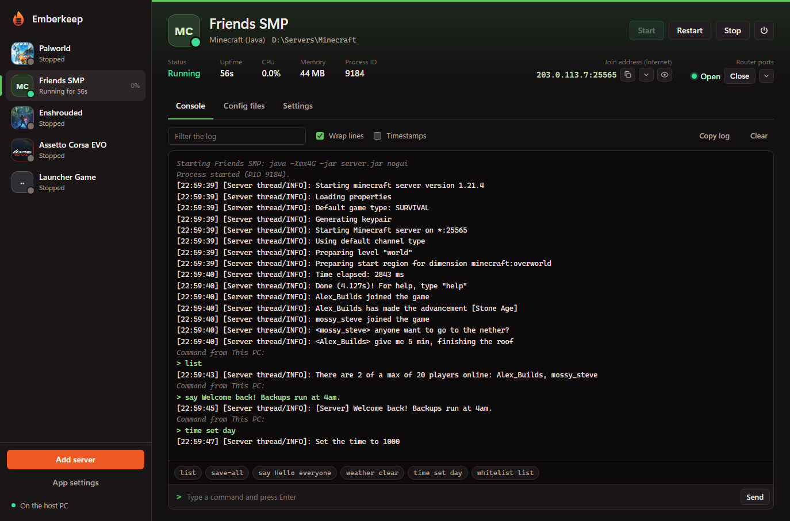
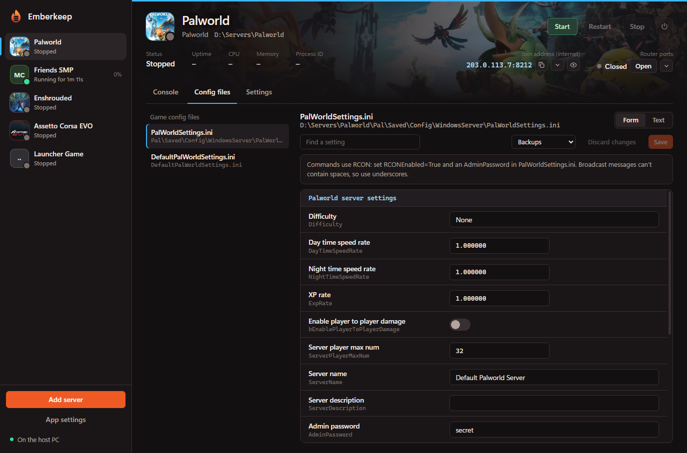
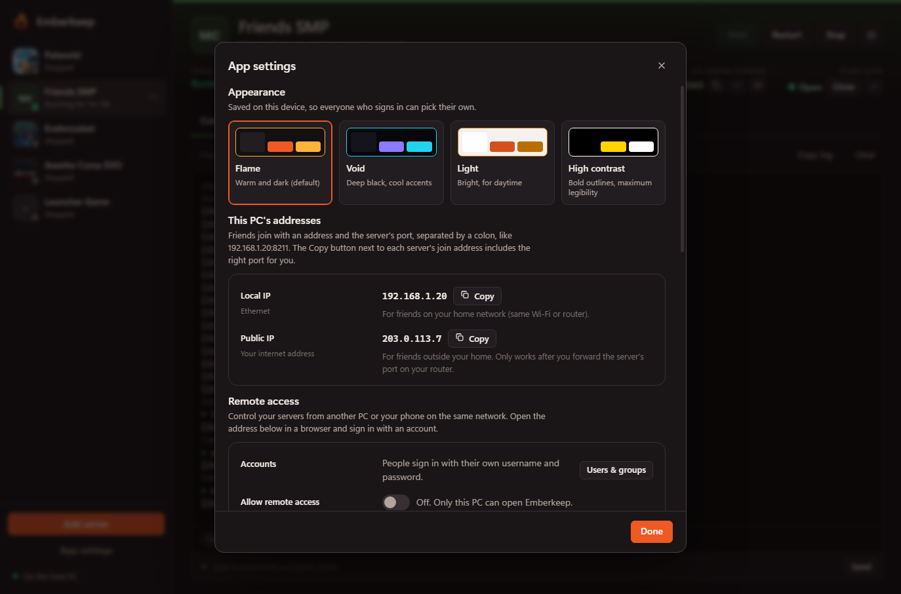
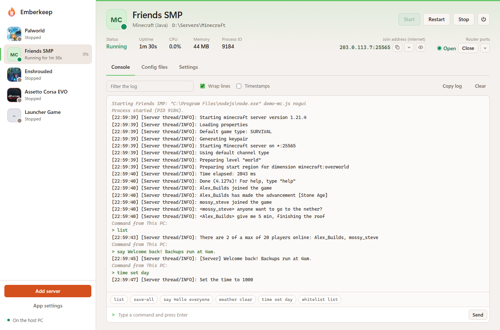

<p align="center"></p>

<h1 align="center">Emberkeep</h1>

A Windows app for running game servers for you and your friends. Run `Emberkeep.exe` on the PC that hosts the servers. You can then manage them from that PC or from any browser on your network.



Emberkeep was called **Hostbay**, and Watchfire was called **PortHop**. Installing Emberkeep over Hostbay upgrades it in place: servers, accounts, settings, the Discord bot token and Watchfire's saved forwards all carry over. The data folders are moved to their new names on first start, and router forwards made under the old names are still recognised.

## Download

Get the installer (**Emberkeep-*version*-Setup.msi**, e.g. Emberkeep-0.3.32-Setup.msi) from the [latest release](../../releases/latest) and run it. It installs for your Windows user only, so it doesn't ask for admin rights. Watchfire, which opens your router's ports for friends outside your home, is included: untick it on the "Choose what to install" page if you don't want it.

1. Download `Emberkeep-<version>-Setup.msi` from the release's **Assets** list.
2. Run it. Windows may show a SmartScreen warning because the installer isn't code-signed: choose **More info → Run anyway**.
3. Open Emberkeep from the Start menu or the desktop shortcut. It finds servers installed through Steam on its own; add any others with **Add server**.

To update, download the newest release and run it: it upgrades in place and keeps your servers and settings. This also works over an old Hostbay install.

Just want the port forwarding? Watchfire has its own download in the [Watchfire repo](https://github.com/GreggsNBacon/watchfire/releases/latest).

### Linux (preview)

Emberkeep runs as a background service (it starts with the machine), with the same interface and features, minus the Windows-only ones (the tray, Start with Windows, restarting the PC, Browse files and the bundled Watchfire: on Linux Emberkeep opens ports with UPnP itself).

- **Ubuntu, Debian, Mint and others based on them:** download `emberkeep_<version>_amd64.deb` and run `sudo apt install ./emberkeep_<version>_amd64.deb` (or open it in your software installer).
- **Any other Linux with systemd** (Fedora, Arch, openSUSE…): download `Emberkeep-<version>-linux-x64.tar.gz`, unpack it and run `sudo ./install.sh`.

**On a desktop**, open Emberkeep from the apps menu: it opens in its own window (with Chrome, Chromium, Edge, Brave or Vivaldi; otherwise a browser tab), signed in as the host. Whoever installed it is added to the `emberkeep` group that allows this; until their next login it asks for the password once.

**On a server without a desktop**, Emberkeep only listens on 127.0.0.1 at first: forward the port over SSH (`ssh -L 8765:127.0.0.1:8765 you@server`) and open the link from `sudo emberkeep link` on your computer. Then create accounts and turn on remote access in App settings, so people can sign in from their browsers.

Installing game servers needs SteamCMD's 32-bit libraries (`sudo apt install lib32gcc-s1`). Enshrouded, V Rising, ARK: Survival Ascended, Sons of the Forest, Conan Exiles and Assetto Corsa EVO only have Windows servers. More in [linux/README.txt](linux/README.txt). Watchfire has its own Linux packages in its repo.

## What it does

- **Finds your servers.** It scans every Steam library, including dedicated servers installed from Steam's Tools library. You can also add any folder, such as a Minecraft server, and Emberkeep recognises the game from the files inside.
- **Edits configs.** It finds each game's config files, using known locations plus a scan of the server folder. You can edit them in a form view (INI, `.properties`, JSON, 7 Days to Die XML, and Palworld's single-line `OptionSettings`) or as plain text. Every save keeps a backup (the last 25 per file), and comments, line endings and encoding are preserved.
- **Controls servers.** Start, Stop, Restart and Force-close. Stop is graceful: it sends the game's own shutdown commands, or presses Ctrl+C. It force-closes only if the server doesn't exit within the timeout. You can also turn on auto-restart after a crash.
- **Sends commands.** Commands go through console input (Minecraft, Terraria, Zomboid, Rust), RCON (Palworld, ARK, V Rising, Conan) or Telnet (7 Days to Die). RCON passwords and ports are read from the game's own config.
- **Shows live logs.** The server's console output and its log files stream in real time, with filtering and timestamps.
- **Offers remote access with accounts.** Create accounts in App settings → Users & groups, turn on remote access, then open `http://<host-ip>:8765` from another PC or your phone. Each person signs in with their own username and password and can change their password. Each account belongs to a group. A group either has full access or a chosen set of permissions: start/stop/restart, force-close, console commands, config files, server settings, router ports, and launch settings. A group can see all servers or only selected ones. Launch settings (executable, arguments, adding and removing servers) is a separate permission because it can run programs on the host. The server checks every request against the signed-in account, so nothing loads before sign-in: the page, its script and all data need a valid session. Hiding the login page in the browser therefore gets you nothing.
- **Discord bot.** In App settings → Discord bot, paste the token of a bot you created in the Discord Developer Portal. Emberkeep encrypts the token for your Windows account (DPAPI) and never shows it again. Invite the bot with the button provided. It can post a **status board** in a channel: one card per server with its status, art and join address. Emberkeep edits the board as servers start and stop, and when your public IP changes. An **updates channel** (it can be the same one) gets news posts: a server crashed, and when it's back; it keeps crashing; your address changed (with the new addresses); a server was updated; a scheduled restart is coming up and when it's done; and, if you want, every start and stop. Crashes and address changes can ping a role you choose, so people get a notification; a server that crashes repeatedly gets one message, not one per crash. The bot reconnects by itself, picks up where it left off after a short drop, and reconnects straight away when the network comes back or the PC wakes; its connection history is in the Discord settings, with **Retry now**. It also adds `/servers` and `/ip` slash commands, and shows "2 of 3 servers online" as its status. You choose which servers are shared, whether offline ones show, whether replies are private, and whether to share your public IP or a host name such as a dynamic DNS name. The bot only shares information; it can't control servers. Only full-access accounts can change these settings.
- **Web link for friends.** The link button next to "On the host PC" at the bottom of the sidebar copies the address people open in a browser to reach Emberkeep: your public address (once Emberkeep's port is open on your router) or your home network address.
- **Starts with Windows, and restarts the PC.** Turn on **Start with Windows** in App settings so Emberkeep opens in the tray when you sign in, and **Start with Emberkeep** in a server's Settings so that server starts with it. **Restart this PC** stops every running server properly first (worlds are saved), then restarts Windows: now, after a one-minute countdown you can cancel, or every day at a time you choose, with a 5-minute warning and a **Skip today** button. Windows only starts programs once someone signs in, so for unattended restarts turn on automatic sign-in for the PC.
- **Updates itself.** Emberkeep checks GitHub for a newer release when it starts and every 12 hours. When one is out, a notice in the sidebar offers **Install update**, which downloads the new installer and runs it (your servers are stopped safely first). Only full-access accounts see it. Turn the check off under App settings → Updates; nothing about you or your servers is sent.
- **Colour themes.** Flame (the default), Void, Light and High contrast, under App settings → Appearance. The choice is saved per device, so each person who signs in picks their own. Watchfire has the same four themes in its Settings.
- **Hides IP addresses.** The eye button next to a join address masks IPs across the UI, which is useful when streaming. Copy buttons still copy the real address.
- **Game artwork.** Each game's Steam art appears as its sidebar badge and as a banner behind the server header. Pictures are downloaded once from Steam and cached in `%APPDATA%\Emberkeep\art`. Custom servers can pick any Steam game's art in Settings → Artwork. For custom servers, Emberkeep looks the game up on Steam by name and uses its art automatically. Steam's "Dedicated Server" and similar suffixes are left out of server names, so lookups match the game.
- **Opens router ports with Watchfire.** Each server has a Router ports control next to its join address: open or close the ports friends need, with per-port status. Emberkeep asks Watchfire to do it (starting Watchfire in the background if needed), so every forward also shows in Watchfire's list and tray and is restored after a router reboot. Without Watchfire, Emberkeep forwards with its own UPnP. Port lists start from Watchfire's game list and follow the ports actually set in the server's config files and launch arguments (for example Enshrouded's gamePort and queryPort, Minecraft's server-port and query.port, or ARK's ?Port and ?QueryPort). Admin ports such as RCON are never opened. You can also type your own list per server; an optional switch opens them while the server runs. The installer includes Watchfire, which also works on its own.
- **Shows join addresses.** Each server shows the address friends join with (your public IP by default, plus the right port, read from the launch arguments or game config), with Copy buttons for local network, VPN and public addresses. IP settings in config files get a "Fill current IP" button. App settings lists all of this PC's addresses with Copy buttons.
- **Installs servers for you.** **Add server → Install a server** has a search box over the games Emberkeep knows. Pick one, choose a folder and press **Install**: Emberkeep downloads the dedicated server with Valve's SteamCMD and adds it, ready to start, with progress (and **Cancel**) in the sidebar. Not in the list? Enter any Steam server's app ID and Emberkeep looks it up first. Emberkeep sets SteamCMD up itself the first time (into `%LOCALAPPDATA%\Emberkeep\SteamCMD`) and only runs it once Windows confirms it's signed by Valve; you can point it at your own SteamCMD in App settings → Installing servers. Servers installed this way get **Update server files** in their menu. Downloads use an anonymous Steam login, so servers Steam only gives to owners of the game (Assetto Corsa EVO, Terraria) are marked as needing to be installed through Steam.
- **Server menu.** The ⋯ button next to Start and Stop, or right-clicking a server in the list, has **Browse files** (opens the server folder in File Explorer, also next to the folder path in the header), **Check files again** (for a server added before it finished downloading: Emberkeep looks for the game, its server program and config files again), **Find setup help online** (web searches for that game's setup guides, config files and ports, opened in your browser), **Copy folder path** and **Remove server**. If a server's program isn't in its folder yet, Emberkeep says so and offers to check again.
- **Basic and Advanced.** The switch at the top right of every page. **Basic** (the default) shows the everyday controls; **Advanced** adds the technical details: process ID, CPU and memory graphs, launch details (program, arguments, environment), console and shutdown settings, log files and a few App settings. The choice is saved per browser.
- **Overview.** All servers as cards with Start, Restart and Stop, how many players are on, and an **Activity** feed: who started, stopped or changed what, crashes, backups, installs and scheduled tasks (filter it by server).
- **Backups.** Each server's **Backups** tab backs up its world/save folders (each game's usual ones, or your own list) and config files as zip files, keeps the newest N, and can back up whenever the server stops. Running servers are asked to save first (where the game allows it). **Restore** needs the server stopped and takes a safety backup of what's there first. Backups go to `%LOCALAPPDATA%\Emberkeep\Backups` unless you choose another folder in App settings.
- **Schedule.** Each server's **Schedule** tab runs restarts, stops, starts, backups, console commands and (for SteamCMD servers) updates, daily at a time on chosen days or every so often. Restarts, stops and updates warn players in the game 10, 5 and 1 minute before, for games with a message command. **Run now** tries a task straight away.
- **Players.** For Minecraft, Terraria and Palworld the header shows who's on (click the number for names).
- **Notifications.** Windows notifications from the tray icon and/or a Discord channel webhook, for crashes, starts and stops, backups, installs/updates and scheduled tasks (App settings → Notifications, with **Send a test**).
- **Also:** **Update before starting** for SteamCMD servers; **Duplicate server** (same settings, optionally copying the files to a new folder as a job with progress); a warning when two servers use the same port; **Notes** per server; **Export/Import** of the server list to move to another PC.
- **Picks up running servers.** If a server was already running when Emberkeep started, Emberkeep detects it and can stop it and show its log files.
- **Learns from a game's own launcher.** Some games set their server up in their own program (Assetto Corsa EVO's Server Launcher, for example). Under Settings → Launch → Launcher, "Learn from launcher" opens that program, waits for it to start the server, and reads the exact program and command line it used, so Emberkeep can then run the server itself. Settings passed encoded inside the command line (Base64, zlib, gzip or a length prefix plus zlib) are saved as JSON files in `EmberkeepConfig`. They show up in Config files and are encoded again each time the server starts. Emberkeep spots a launcher in a server folder on its own: a windowed program next to the console server with a name like "launcher" or "config".

## Screenshots

| | |
|---|---|
|  |  |
| **Config files.** Each game's settings as a form, with backups on every save. | **App settings.** Colour themes, this PC's addresses with Copy buttons, and remote access. |
|  | |
| **Light theme.** Also Flame, Void and High contrast. | |

## Supported games

Palworld, Enshrouded, Valheim, Satisfactory, Minecraft (Java and Bedrock), V Rising, 7 Days to Die, Project Zomboid, Terraria, ARK: Survival Evolved, ARK: Survival Ascended, Sons of the Forest, Conan Exiles, Core Keeper, Rust and Assetto Corsa EVO (set it up once in its Server Launcher, then use Learn from launcher). Any other server can be added as **Other / Custom**: you choose the executable, and Emberkeep captures its console and finds config-looking files in its folder.

Game definitions live in `src/Emberkeep/Core/GameCatalog.cs`. Adding a game means adding one entry there.

## Build

Requires the .NET 10 SDK. Everything else, including the WiX toolset for the installer, comes from NuGet automatically.

```powershell
.\build.ps1
```

This produces:

- `publish\Emberkeep.exe`: the app as a single self-contained file that doesn't need a separate .NET install. You can run it as-is.
- `dist\Emberkeep-<version>-Setup.msi`: the installer to give to friends.

For Linux, `.\build-linux.ps1` cross-compiles `dist\emberkeep_<version>_amd64.deb` and `dist\Emberkeep-<version>-linux-x64.tar.gz` (needs Node, which writes the packages). It also runs on Linux with PowerShell; the [Linux workflow](.github/workflows/linux.yml) installs the .deb on Ubuntu and tests it.

The window uses the Microsoft Edge WebView2 Runtime, which is built into Windows 11.

## Installer

The installer installs Emberkeep for the current Windows user, into `%LOCALAPPDATA%\Programs\Emberkeep`, so no admin prompt appears. A "Choose what to install" page has a tickbox for Emberkeep and one for Watchfire (installed to `%LOCALAPPDATA%\Programs\Watchfire`), so you can install either on its own or both. On an upgrade, the ticks start out matching what's already installed. Each app gets Start menu and desktop shortcuts, and the last page offers to launch whichever app you installed. Uninstall it from Settings > Apps. Uninstalling keeps your server list and settings in `%APPDATA%\Emberkeep`.

To release a new version, commit and run `.\build.ps1`. The version is `0.3.<commit count>`, worked out by `build.ps1`. The installer takes its version from the exe and upgrades older installs in place.

Silent install, for example for scripting: `msiexec /i Emberkeep-0.3.32-Setup.msi /qn` (installs both; add `ADDLOCAL=Emberkeep` or `ADDLOCAL=Watchfire` for just one, and `INSTALLDESKTOPSHORTCUT=0` to skip the desktop shortcuts).

The installer's source is in `installer/`. `Package.wxs` defines the package. The artwork is generated by `installer\Assets\make-art.ps1`.

## Where things are stored

- Settings and the server list: `%APPDATA%\Emberkeep\settings.json`
- Config backups: `%APPDATA%\Emberkeep\backups\`
- Set the `EMBERKEEP_DATA_DIR` environment variable to use a different folder, for example when testing. The old `HOSTBAY_*` variable names still work.

## How it's built

- **`Core/`**: the game catalog, the Steam library scanner (VDF/ACF parser), config discovery, process control (Ctrl+C delivery, process-tree stats and kill), the RCON and Telnet clients, and log tailing.
- **`Web/`**: an embedded Kestrel server providing the REST API and live log/status streams (Server-Sent Events). It also handles sign-in: the desktop window uses a per-launch token, and other browsers sign in with an account (PBKDF2-hashed passwords, lockout after repeated failures). Sign-in uses a session cookie, permissions are enforced per request on the server, and changes require an `X-Emberkeep` header so other websites can't make them.
- **`Desktop/`**: the WinForms window hosting WebView2, the tray icon, single-instance handling, and a graceful stop of all servers on exit.
- **`wwwroot/`**: the UI, in plain HTML, CSS and JavaScript embedded in the exe, with no build step.
- **`tests/FakeServer`**: a stand-in game server (console output, a log file, console input, Ctrl+C handling, an RCON server) used to exercise Emberkeep without installing real games.
- **`tests/FakeDiscord`**: a stand-in for Discord's REST API and gateway, used to test the bot without a real token (`EMBERKEEP_DISCORD_API=http://127.0.0.1:9555/api/v10`).
- **`tests/Checks`**: quick checks of name tidying, router ports read from config files and launch arguments, and (with `--online`) the Steam art lookup. Run with `dotnet run --project testsChecks`.
- **`tests/FakeLauncher`**: a windowed stand-in for a game's launcher that starts `FakeServer` with Assetto Corsa EVO-style encoded settings, used to test Learn from launcher.

##  Watchfire

Watchfire (`..\Watchfire`) is a separate app for forwarding game ports. Emberkeep finds a running copy through `%LOCALAPPDATA%\Watchfire\instance.json` and uses its local API (`/api/hello`, `/api/forwarded`, `/api/forward`, `/api/remove`). Forwards Emberkeep makes are named `Emberkeep: <server name>` in Watchfire. `build.ps1` builds Watchfire from source when Node is available (on PATH, or `$env:EMBERKEEP_NODE`) and bundles it into the installer, which puts it in `%LOCALAPPDATA%\Programs\Watchfire`.

To go back to the version before Watchfire (then called PortHop): the git tag `v0.2-pre-porthop` (branch `hostbay-v1`), or the saved installer `releases\Hostbay-0.2.4.7-Setup.msi`.

## Not in this version

- Installing or updating servers through SteamCMD.
- Satisfactory's HTTPS admin API and Rust's WebRCON, so those games use console input or have no commands.
- Scheduled restarts and backups of world saves.
